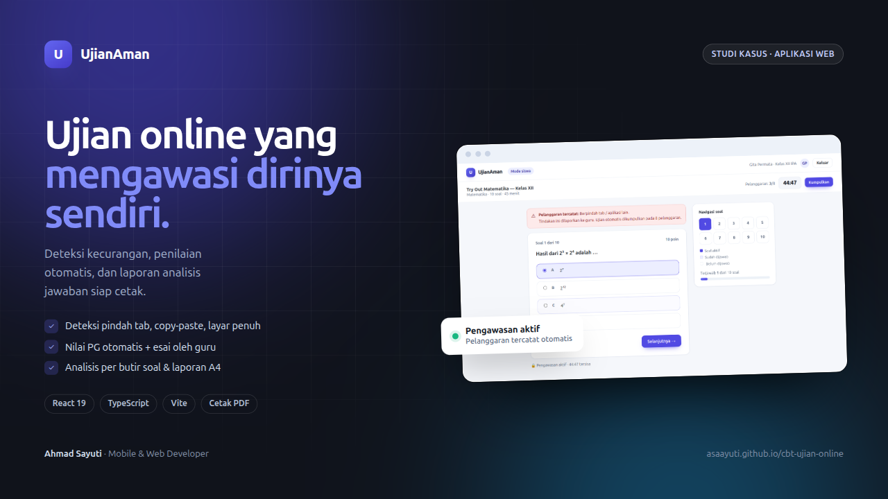
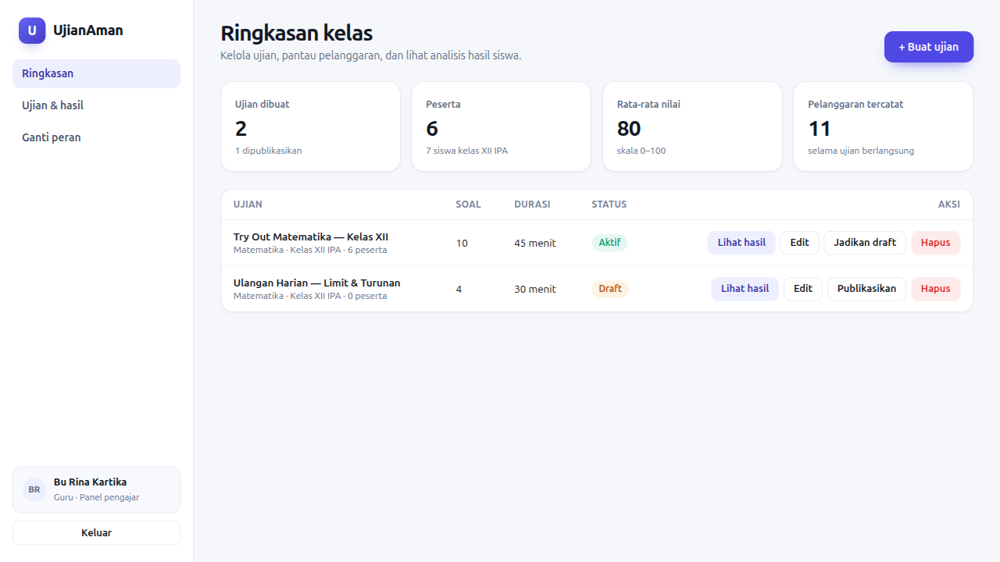
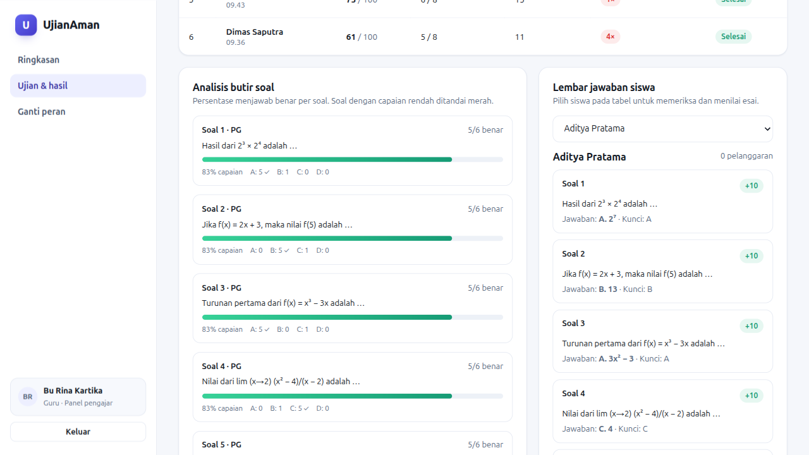
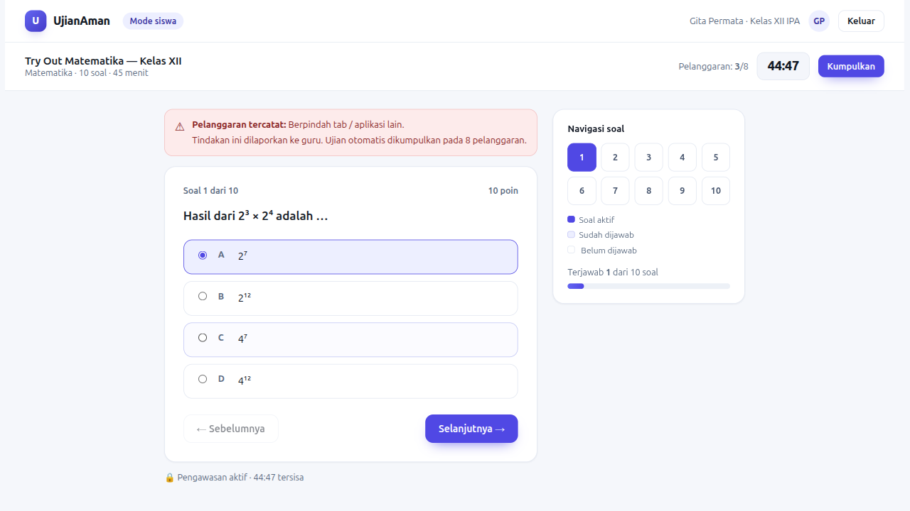
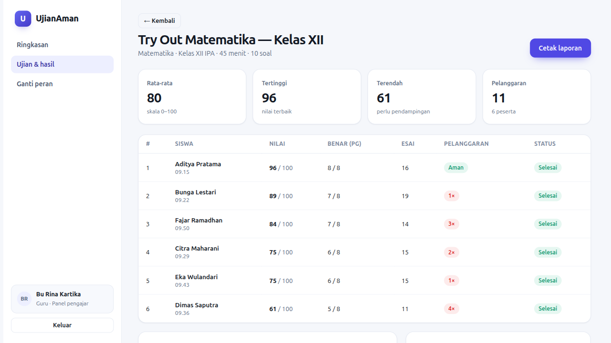

# UjianAman — Aplikasi Ujian Online dengan Deteksi Kecurangan

Aplikasi web ujian/tryout untuk sekolah: pengawasan saat ujian, penilaian otomatis,
analisis butir soal, dan laporan yang siap dicetak. Dibangun sebagai studi kasus
yang benar-benar bisa dicoba, bukan mockup.

**Demo:** https://asaayuti.github.io/cbt-ujian-online/



## Fitur

- **Dua peran** — guru mengelola ujian dan hasil; siswa hanya melihat ujian yang dipublikasikan.
- **Bank soal** — pilihan ganda dan esai, poin per soal, kunci jawaban, tambah/hapus soal.
- **Timer yang tidak bisa diakali** — batas waktu dihitung dari waktu mulai yang tersimpan,
  jadi refresh atau menutup tab tidak mengembalikan waktu.
- **Deteksi kecurangan** — pindah tab/aplikasi, jendela kehilangan fokus, keluar layar penuh,
  copy/cut/paste, dan klik kanan. Setiap kejadian dicatat dengan waktunya, ditampilkan
  sebagai peringatan, dan dikirim ke laporan guru. Ujian dikumpulkan otomatis pada
  8 pelanggaran.
- **Penilaian** — pilihan ganda dinilai otomatis saat dikumpulkan; esai dinilai guru
  dengan input poin; total dihitung ulang.
- **Analisis** — capaian per butir soal, distribusi pilihan jawaban, rata-rata esai,
  ranking siswa, dan rekap pelanggaran.
- **Cetak** — tombol cetak dengan tata letak A4 (rekap nilai + analisis butir soal).

| Dashboard guru | Analisis hasil |
| --- | --- |
|  |  |

| Layar ujian siswa | Rekap nilai |
| --- | --- |
|  |  |

## Stack

- React 19 + TypeScript + Vite
- CSS murni (tanpa framework UI)
- `localStorage` sebagai penyimpanan mode demo
- Siap dipindah ke REST API + PostgreSQL untuk produksi

## Menjalankan

```bash
npm install
npm run dev      # http://localhost:5173
npm run build    # hasil di dist/
```

Deploy ke GitHub Pages:

```bash
npm run build
npx gh-pages -d dist
```

Base path mengikuti nama repo (`/cbt-ujian-online/`) dan bisa dioverride lewat
`VITE_BASE` saat build.

## Catatan produksi

Demo ini menyimpan data di browser. Untuk dipakai sekolah:

1. Ganti lapisan penyimpanan dengan API + PostgreSQL, tambahkan autentikasi akun sekolah.
2. Catat pelanggaran di sisi server (bukan hanya klien) agar tidak bisa dimanipulasi.
3. Simpan jawaban secara incremental ke server, bukan hanya di perangkat.
4. Tambahkan proctoring webcam/AI bila diperlukan — butuh biaya server dan kebijakan privasi.

---

Dibuat oleh **Ahmad Sayuti** — Mobile & Web Developer · [github.com/asaayuti](https://github.com/asaayuti)
